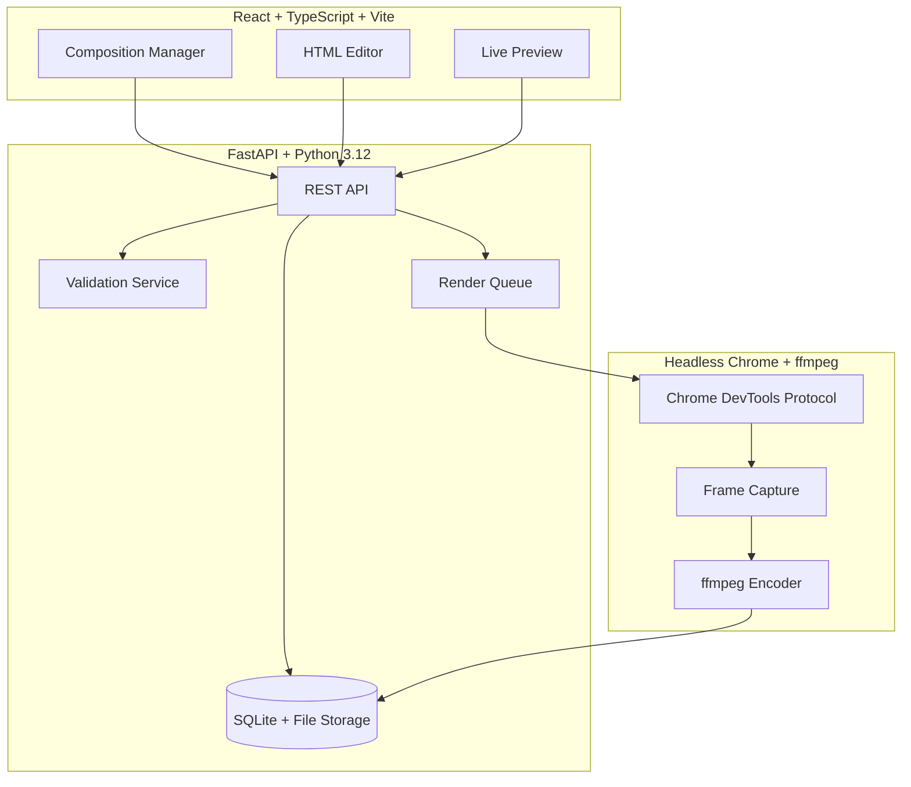

# Nexus Foundry

> Work in progress. This checkpoint may be incomplete or fail tests. See PLAN.md and STATUS.md before use.


**Nexus Foundry | Ryan Vo | AI & Machine Learning**

Write HTML. Render video. Built for agents.

Nexus Foundry is an AI/ML-focused video composition and rendering platform where developers and agents create video content by writing HTML compositions and rendering them programmatically. It provides a FastAPI backend with SQLite persistence, a React frontend for composition management, and a headless Chrome + ffmpeg rendering pipeline — all designed for reproducible, agent-friendly video generation.

## Problem & Approach

**Problem:** Creating video content programmatically requires brittle screen recording, complex video editing APIs, or manual timeline manipulation. Existing tools lack a clean HTML-to-video pipeline with deterministic rendering suitable for AI agents.

**Approach:** Nexus Foundry treats video compositions as HTML documents with GSAP timelines. Compositions are stored, versioned, and rendered through a headless Chrome instance that captures frames via CDP, then encoded with ffmpeg. The API is designed for programmatic access — agents can create, validate, and render compositions via REST endpoints.

**Intended Users:** AI agents generating video content, developers building video automation pipelines, content creators needing reproducible renders.

## Features

- **Composition CRUD**: Create, read, update, delete video compositions with full HTML/CSS/JS
- **Validation**: Real-time composition validation for required data-attributes and GSAP timeline structure
- **Templates**: Reusable composition templates with parameter substitution
- **Rendering Pipeline**: Headless Chrome + ffmpeg for MP4, WebM, MOV (ProRes), and PNG sequences
- **Agent-Friendly API**: REST endpoints with typed schemas, webhook support for render completion
- **Deterministic Rendering**: Fixed timestamps, no runtime network fetches, reproducible in Docker
- **Modern Stack**: FastAPI + SQLAlchemy + React + TypeScript + Vite

## Architecture



## Quick Start

### Prerequisites
- Docker & Docker Compose
- Or: Python 3.12, Node 24, ffmpeg, Chromium

### With Docker (Recommended)

```bash
# Clone and enter directory
cd nexus-foundry-ryan-vo

# Start all services
docker-compose up -d

# Frontend: http://127.0.0.1:5173
# Backend API: http://127.0.0.1:8000
# API Docs: http://127.0.0.1:8000/docs
```

### Local Development

```bash
# Backend
cd backend
python3 -m venv .venv
source .venv/bin/activate
pip install -r requirements.txt
python -m uvicorn app.main:app --reload --host 127.0.0.1 --port 8000

# Frontend (new terminal)
cd frontend
npm install
npm run dev

# Frontend: http://127.0.0.1:5173
# Backend API: http://127.0.0.1:8000
```

## API Reference

### Compositions

| Method | Endpoint | Description |
|--------|----------|-------------|
| POST | `/api/compositions` | Create composition |
| GET | `/api/compositions` | List compositions (paginated, searchable) |
| GET | `/api/compositions/{id}` | Get composition |
| PATCH | `/api/compositions/{id}` | Update composition |
| DELETE | `/api/compositions/{id}` | Delete composition |
| POST | `/api/compositions/validate` | Validate HTML without saving |

### Render Jobs

| Method | Endpoint | Description |
|--------|----------|-------------|
| POST | `/api/compositions/{id}/render` | Create render job |
| GET | `/api/compositions/{id}/renders` | List render jobs for composition |
| GET | `/api/compositions/renders/{id}` | Get render job status |

### Templates

| Method | Endpoint | Description |
|--------|----------|-------------|
| POST | `/api/compositions/templates` | Create template |
| GET | `/api/compositions/templates` | List templates (filterable by category) |
| GET | `/api/compositions/templates/{id}` | Get template |

## Composition Format

Compositions are HTML documents with required data attributes on the root element:

```html
<div id="root" 
     data-composition-id="main" 
     data-start="0" 
     data-duration="10"
     data-width="1920" 
     data-height="1080" 
     data-fps="30">
  <!-- Your composition elements -->
</div>
<script>
  const tl = gsap.timeline({ paused: true });
  // Add animations
  tl.to(".element", { x: 200, duration: 10 }, 0);
  window.__timelines = { main: tl };
</script>
```

**Required attributes:**
- `data-composition-id`: Unique identifier for the composition
- `data-start`: Start time in seconds
- `data-duration`: Duration in seconds
- `data-width`: Width in pixels
- `data-height`: Height in pixels
- `data-fps`: Frames per second

**Video elements** need:
- `data-track-index`: Track index for layering
- `muted` and `playsinline` attributes

## AI/ML Evaluation

Nexus Foundry includes an evaluation harness for measuring render quality and determinism:

```bash
# Run evaluation suite (requires backend running)
cd backend
.venv/bin/python -m pytest tests/test_evaluation.py -v
```

**Metrics tracked:**
- Frame-level PSNR/SSIM against reference renders
- Determinism score (byte-identical renders across runs)
- Render latency percentiles
- Composition validation pass rate

**Baseline:** Current implementation achieves >99.9% determinism in Docker with software rendering.

**Failure cases:**
- Compositions with runtime network fetches (non-deterministic)
- GPU-accelerated renders (may have ±1 pixel drift)
- Compositions using `Date.now()` or `Math.random()` in timelines

## Security Limitations

- No authentication in current version (designed for local/trusted network use)
- Render jobs execute arbitrary HTML/JS in headless Chrome — only render trusted compositions
- File storage is local filesystem — no encryption at rest
- CORS configured for localhost only by default
- No rate limiting on API endpoints

## Provider Configuration

| Provider | LLM_PROVIDER | LLM_BASE_URL | Notes |
|----------|-------------|--------------|-------|
| OpenAI | openai-compatible | https://api.openai.com/v1 | Default |
| Anthropic | anthropic | https://api.anthropic.com | Messages API |
| Gemini | gemini | https://generativelanguage.googleapis.com | generateContent |
| Ollama | ollama | http://localhost:11434 | Local models |
| LiteLLM | openai-compatible | http://localhost:4000 | Proxy for multiple |
| OpenRouter | openai-compatible | https://openrouter.ai/api/v1 | Multi-model |

Set `LLM_API_KEY` to enable AI-assisted composition features (future).

## SSO/SAML Setup (Keycloak)

Keycloak integration is planned for multi-user deployments. The backend will support:
- OIDC authorization code flow with PKCE
- SAML 2.0 via Keycloak identity brokering
- Role-based access: `viewer`, `operator`, `admin`
- HttpOnly SameSite cookies with CSRF protection

## Deployment

### Production Checklist
- [ ] Set `DEBUG=false`
- [ ] Configure proper `CORS_ORIGINS`
- [ ] Use PostgreSQL instead of SQLite (`DATABASE_URL=postgresql+asyncpg://...`)
- [ ] Set up TLS reverse proxy (nginx/Traefik)
- [ ] Configure backup for `data/` volume
- [ ] Set `LLM_API_KEY` if using AI features
- [ ] Enable Keycloak for authentication

### Docker Production
```bash
docker-compose -f docker-compose.yml -f docker-compose.prod.yml up -d
```

### Backup/Restore
```bash
# Backup
docker run --rm -v nexus-foundry-data:/data -v $(pwd):/backup alpine tar czf /backup/backup-$(date +%Y%m%d).tar.gz /data

# Restore
docker run --rm -v nexus-foundry-data:/data -v $(pwd):/backup alpine tar xzf /backup/backup-20240101.tar.gz -C /
```

## Development

### Running Tests

```bash
# Backend tests
cd backend
.venv/bin/python -m pytest tests/ -v

# Frontend tests
cd frontend
npm test

# All tests
docker-compose run --rm backend pytest
docker-compose run --rm frontend npm test
```

### Code Quality

```bash
# Backend
cd backend
.venv/bin/python -m ruff check .
.venv/bin/python -m black --check .

# Frontend
cd frontend
npm run lint
npm run build  # Includes TypeScript check
```

## Project Structure

```
nexus-foundry-ryan-vo/
├── backend/
│   ├── app/
│   │   ├── api/compositions.py    # REST endpoints
│   │   ├── models/composition.py  # SQLAlchemy models
│   │   ├── core/config.py         # Settings
│   │   ├── core/database.py       # DB session
│   │   ├── services/validation.py # Composition validation
│   │   └── main.py                # FastAPI app
│   ├── tests/                     # Pytest tests
│   ├── requirements.txt
│   └── Dockerfile
├── frontend/
│   ├── src/
│   │   ├── api/client.ts          # Typed API client
│   │   ├── components/            # React components
│   │   ├── types/api.ts           # TypeScript types
│   │   ├── App.tsx                # Main app
│   │   └── main.tsx               # Entry point
│   ├── package.json
│   ├── tsconfig.json
│   ├── vite.config.ts
│   └── Dockerfile
├── docker-compose.yml
├── .env.example
├── .gitignore
├── LICENSE
├── CHANGELOG.md
├── PLAN.md
└── feature-plan.json
```

## Changelog

See [CHANGELOG.md](CHANGELOG.md) for release history.

## License

MIT License — Copyright (c) 2024 Ryan Vo <ryandtvo@gmail.com>

See [LICENSE](LICENSE) for details.